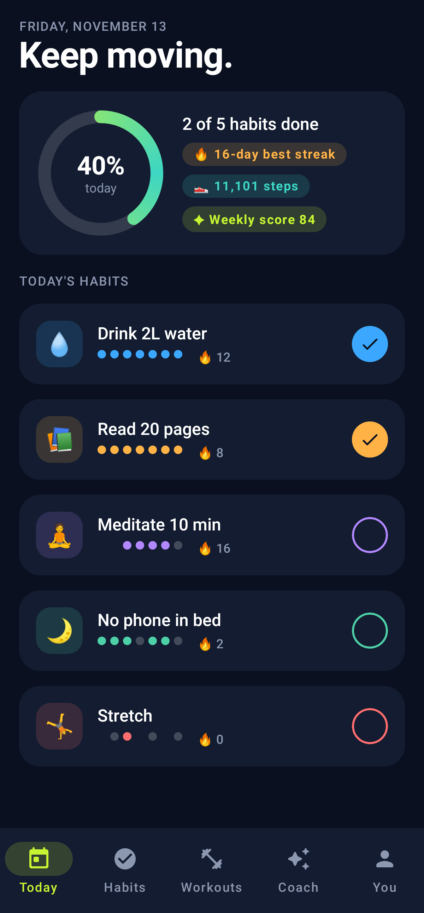
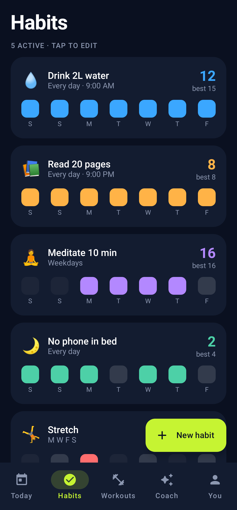
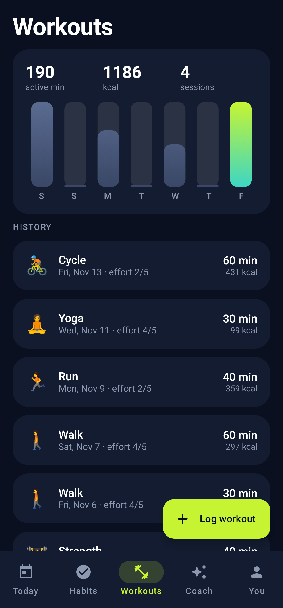
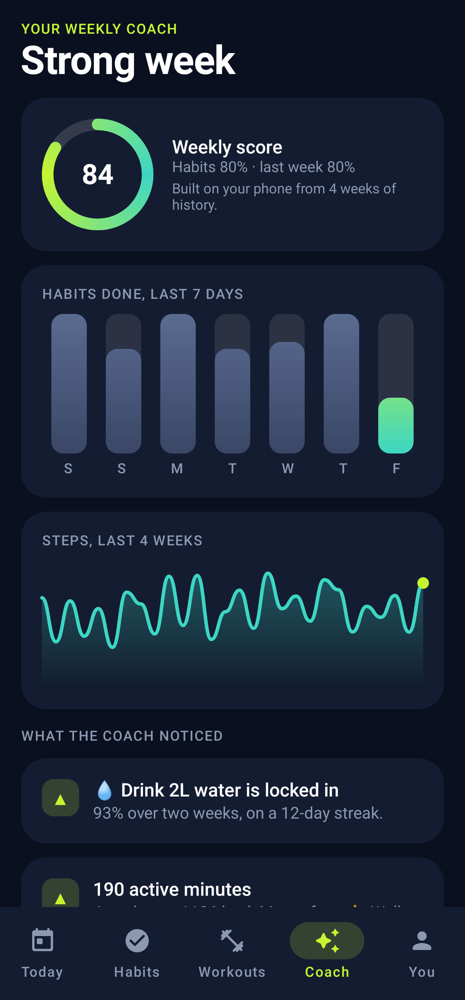
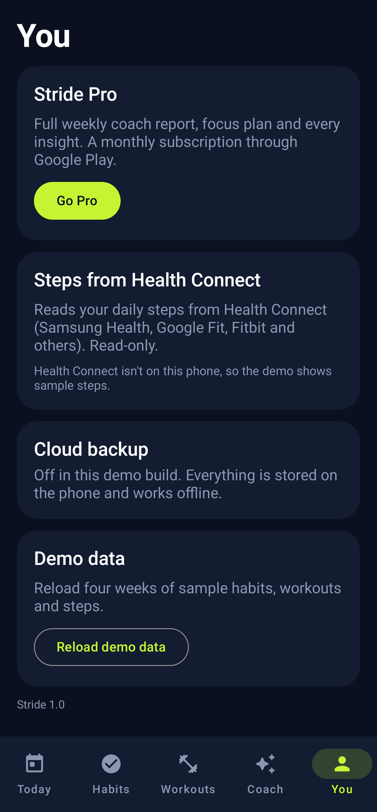

# Stride: AI habit & fitness coach for Android

A native Android app built with **Kotlin and Jetpack Compose**. Track daily habits and workouts, keep streaks alive, pull in your steps from Health Connect, and get a **weekly AI-style coaching report** generated on the phone from four weeks of your history. Works fully offline; cloud backup to Firestore switches on with a key.

<p>
  
  
  
  
  
</p>

## Try it

| Platform | How |
| --- | --- |
| **Android 9+** | Download `app-release.apk` from the [latest release](https://github.com/neomaverick1/stride/releases/latest) and open it on your phone. Four weeks of demo data load on first launch. |

Every push to `main` runs the unit and screenshot tests and publishes a new APK automatically ([`.github/workflows/build.yml`](.github/workflows/build.yml)).

## Features

| Area | What it does |
| --- | --- |
| **Today** | Animated progress ring, best streak, today's steps and weekly score. Tap a habit to check it off (with haptics). |
| **Habits** | Create and edit habits with icon, colour, repeat days (every day, weekdays, any mix) and a reminder time. Each card shows the current streak, best streak and the last 7 days. |
| **Workouts** | Log runs, walks, strength, cycling, yoga or HIIT with duration and effort; calories are estimated. Weekly totals and a 7-day bar chart. |
| **Weekly coach** | A 0-100 score and a ranked report: week-over-week change, strongest and weakest weekday, the habit that's locked in and the one at risk, step trend, the link between steps and habits, training load, and one focus for next week. |
| **Health Connect** | Reads daily step totals (Samsung Health, Google Fit, Fitbit and others write there). Read-only permission with the rationale screen Android requires. |
| **Reminders** | One WorkManager job per habit; it fires only if the habit isn't done yet and reschedules itself for the next due day. |
| **Home-screen widget** | Jetpack Glance widget with today's progress and best streak. |
| **Stride Pro** | Monthly subscription through Google Play Billing (purchase, acknowledge, restore). The demo isn't listed on Play, so it offers a free demo unlock that runs the same "is Pro" path. |

## How it's built

- **Offline-first:** Room is the single source of truth. Every write lands locally first; [`CloudSync`](app/src/main/java/com/neomaverick/stride/sync/CloudSync.kt) mirrors changes to Cloud Firestore when `STRIDE_FIREBASE_*` keys are set at build time, and is a no-op otherwise, so the demo needs no account.
- **The coach:** [`InsightEngine`](app/src/main/java/com/neomaverick/stride/domain/InsightEngine.kt) is pure Kotlin: completion rates over scheduled days only, weekday patterns, Pearson correlation between steps and habit completion, and a weighted score. It sits behind an `InsightProvider` interface, so an LLM-backed provider can replace it without touching the UI. Running on the phone means no network, no cost and no data leaving the device.
- **Streak maths** handles partial schedules (weekday-only habits skip weekends) and never breaks a streak for a day that isn't over yet.
- **Architecture:** single-activity Compose app, `ViewModel` + `StateFlow`, Navigation Compose, Material 3 with a custom dark theme, and hand-drawn Canvas charts (ring, bars, smooth line).
- **Tests:** JVM unit tests for the streak maths and the coach, plus Robolectric + Roborazzi screenshot tests that render every screen with the demo data (the images above come from them).

```
app/src/main/java/com/neomaverick/stride/
  data/        Room entities, DAOs, repository, demo data
  domain/      Streaks, InsightEngine (pure Kotlin, unit-tested)
  health/      Health Connect steps
  sync/        Firestore backup (optional)
  billing/     Play Billing subscription
  reminders/   WorkManager reminders + notifications
  widget/      Glance home-screen widget
  ui/          Compose screens, theme, charts
```

## Build it yourself

```bash
./gradlew testDebugUnitTest      # unit + screenshot tests
./gradlew recordRoborazziDebug   # re-render the README screenshots
./gradlew assembleRelease        # APK in app/build/outputs/apk/release
```

Optional cloud backup: set `STRIDE_FIREBASE_PROJECT_ID`, `STRIDE_FIREBASE_APP_ID` and `STRIDE_FIREBASE_API_KEY` before building.

## License

MIT
